# Arquitectura · Mi proyecto

> Generado con Estoria Spec Tool (vista Mapa) a partir de `docs/architecture/_code.json` (2026-10-29). No se edita a mano: se vuelve a generar después de `php artisan docs:map`.

Laravel 13.6.0 · 61 modelos · 27 módulos

## Mapa de módulos

Las flechas van del módulo que guarda la llave foránea al módulo del que depende. Borde punteado: en desarrollo (spec aprobado).

```mermaid
flowchart LR
  subgraph area_0["Configuración"]
    direction TB
    m_usuarios["<b>Usuarios</b><br/><small>User · PurchaseOrderMilestoneAdjustment</small>"]:::impl
    m_concepts["<b>Conceptos</b><br/><small>Concept</small>"]:::impl
    m_concept_categories["<b>Familias</b><br/><small>ConceptCategory · ConceptSubcategory</small>"]:::impl
    m_notifications["<b>Notificaciones</b><br/><small>Notification</small>"]:::impl
  end
  subgraph area_1["Portal Proveedor"]
    direction TB
    m_supplier_portal["<b>Mis Órdenes de Compra</b><br/><small>PurchaseOrder · PurchaseOrderAnnex</small>"]:::impl
    m_suppliers["<b>Proveedores</b><br/><small>PurchaseOrder · Supplier</small>"]:::impl
    m_mobile_assets["<b>Bienes Móviles</b><br/><small>MobileAsset · MobileAssetDocument</small>"]:::impl
    m_projects["<b>Proyectos</b><br/><small>Project · ProjectEstimate · ProjectAgreement · ProjectDocument · ProjectTask</small>"]:::impl
    m_my_projects["<b>Mis Proyectos</b><br/><small>Project</small>"]:::impl
    m_tool_categories["<b>Categorias</b><br/><small>ToolCategory</small>"]:::impl
    m_tool_controls["<b>Control de uso</b><br/><small>ToolControl</small>"]:::impl
    m_tools["<b>Registro</b><br/><small>Tool</small>"]:::impl
  end
  subgraph area_2["Almacén"]
    direction TB
    m_purchase_orders["<b>Buscar OCs</b><br/><small>PurchaseOrder</small>"]:::impl
    m_material_requests["<b>SOLMATs</b><br/><small>MaterialRequest</small>"]:::impl
    m_material_vouchers["<b>Vales de Material</b><br/><small>MaterialVoucher · MaterialVoucherItem</small>"]:::impl
  end
  subgraph area_3["Compras"]
    direction TB
    m_purchase_requests["<b>SOLCOMs</b><br/><small>PurchaseRequest</small>"]:::impl
    m_invoices["<b>Contado</b><br/><small>PurchaseOrderInvoice</small>"]:::impl
  end
  subgraph area_4["Sin área"]
    direction TB
    m_supplier_contacts["<b>Supplier Contacts</b><br/><small>SupplierContact</small>"]:::impl
    m_supplier_locations["<b>Supplier Locations</b><br/><small>SupplierLocation</small>"]:::impl
    m_maintenance_logs["<b>Maintenance Logs</b><br/><small>MaintenanceLog</small>"]:::impl
    m_project_works["<b>Project Works</b><br/><small>ProjectWork</small>"]:::impl
    m_tool_calibrations["<b>Tool Calibrations</b><br/><small>ToolCalibration</small>"]:::impl
    m_milestones["<b>Milestones</b><br/><small>PurchaseOrderMilestone · PurchaseOrderMilestoneFulfillment</small>"]:::impl
    m_evidences["<b>Evidences</b><br/><small>PurchaseOrderEvidence</small>"]:::impl
  end
  subgraph area_5["Recursos Humanos"]
    direction TB
    m_human_resources["<b>Cuadrillas</b><br/><small>WorkerGroup · WorkerAttendance · Worker · WorkerFile · WorkerDc3 · WorkerTermination · WorkerVacation · PositionCategory · PayrollPeriod · PayrollLine · Incentive · PieceworkWeeklyEntry · PayrollLineExtraPayment · PieceworkDailyAmount</small>"]:::impl
  end
  subgraph area_6["Pagos"]
    direction TB
    m_payments["<b>Autorizaciones</b><br/><small>Payment</small>"]:::impl
  end
  subgraph area_7["Inventario"]
    direction TB
    m_stocks["<b>Consulta</b><br/><small>StockEntry · StockExit</small>"]:::impl
  end
  m_supplier_portal --> m_usuarios
  m_supplier_portal --> m_suppliers
  m_supplier_portal --> m_mobile_assets
  m_supplier_portal --> m_projects
  m_supplier_portal --> m_project_works
  m_supplier_portal --> m_purchase_requests
  m_purchase_orders --> m_usuarios
  m_purchase_orders --> m_suppliers
  m_purchase_orders --> m_mobile_assets
  m_purchase_orders --> m_projects
  m_purchase_orders --> m_project_works
  m_purchase_orders --> m_supplier_portal
  m_purchase_orders --> m_purchase_requests
  m_purchase_requests --> m_material_requests
  m_purchase_requests --> m_projects
  m_purchase_requests --> m_project_works
  m_purchase_requests --> m_usuarios
  m_material_requests --> m_projects
  m_material_requests --> m_concept_categories
  m_material_requests --> m_usuarios
  m_suppliers --> m_usuarios
  m_suppliers --> m_mobile_assets
  m_suppliers --> m_projects
  m_suppliers --> m_project_works
  m_suppliers --> m_supplier_portal
  m_suppliers --> m_purchase_requests
  m_supplier_contacts --> m_suppliers
  m_supplier_locations --> m_suppliers
  m_maintenance_logs --> m_mobile_assets
  m_projects --> m_usuarios
  m_my_projects --> m_usuarios
  m_project_works --> m_projects
  m_project_works --> m_usuarios
  m_human_resources --> m_project_works
  m_concepts --> m_concept_categories
  m_tool_controls --> m_tools
  m_tool_controls --> m_project_works
  m_tools --> m_tool_categories
  m_tool_calibrations --> m_tools
  m_notifications --> m_usuarios
  m_milestones --> m_supplier_portal
  m_payments --> m_invoices
  m_payments --> m_milestones
  m_invoices --> m_supplier_portal
  m_evidences --> m_supplier_portal
  m_evidences --> m_milestones
  m_evidences --> m_invoices
  m_evidences --> m_usuarios
  m_stocks --> m_concepts
  m_stocks --> m_tools
  m_stocks --> m_usuarios
  m_stocks --> m_human_resources
  m_stocks --> m_projects
  m_stocks --> m_project_works
  m_material_vouchers --> m_suppliers
  m_material_vouchers --> m_projects
  m_material_vouchers --> m_project_works
  m_material_vouchers --> m_usuarios
  svc_audit(["Auditoría · NotificationService"]):::svc
  svc_disk_s3[("Storage · s3")]:::svc
  svc_roles{{"Roles y permisos"}}:::svc
  m_purchase_orders -.-> svc_audit
  m_suppliers -.-> svc_audit
  m_supplier_contacts -.-> svc_audit
  m_supplier_locations -.-> svc_audit
  m_mobile_assets -.-> svc_audit
  m_projects -.-> svc_audit
  m_project_works -.-> svc_audit
  m_human_resources -.-> svc_audit
  m_tool_controls -.-> svc_audit
  m_tools -.-> svc_audit
  m_milestones -.-> svc_audit
  m_payments -.-> svc_audit
  m_invoices -.-> svc_audit
  m_evidences -.-> svc_audit
  m_stocks -.-> svc_audit
  m_material_vouchers -.-> svc_audit
  m_purchase_requests -.-> svc_disk_s3
  m_material_requests -.-> svc_disk_s3
  m_suppliers -.-> svc_disk_s3
  m_supplier_locations -.-> svc_disk_s3
  m_mobile_assets -.-> svc_disk_s3
  m_maintenance_logs -.-> svc_disk_s3
  m_projects -.-> svc_disk_s3
  m_human_resources -.-> svc_disk_s3
  m_tools -.-> svc_disk_s3
  m_tool_calibrations -.-> svc_disk_s3
  m_milestones -.-> svc_disk_s3
  m_payments -.-> svc_disk_s3
  m_stocks -.-> svc_disk_s3
  m_usuarios -.-> svc_roles
  classDef impl fill:#ffffff,stroke:#5b8dee,stroke-width:1.5px,color:#1a1f2e
  classDef dev fill:#ffffff,stroke:#b08d22,stroke-width:1.5px,stroke-dasharray:6 4,color:#1a1f2e
  classDef plan fill:#ffffff,stroke:#a3abbd,stroke-width:1.5px,stroke-dasharray:2 3,color:#1a1f2e,opacity:0.75
  classDef pub fill:#ffffff,stroke:#2c9590,stroke-width:1.5px,color:#1a1f2e
  classDef svc fill:#eceef5,stroke:#8b92a8,stroke-width:1px,color:#1a1f2e
  style area_0 fill:#f4f5f9,stroke:#c9cfdf,color:#48516e
  style area_1 fill:#f4f5f9,stroke:#c9cfdf,color:#48516e
  style area_2 fill:#f4f5f9,stroke:#c9cfdf,color:#48516e
  style area_3 fill:#f4f5f9,stroke:#c9cfdf,color:#48516e
  style area_4 fill:#f4f5f9,stroke:#c9cfdf,color:#48516e
  style area_5 fill:#f4f5f9,stroke:#c9cfdf,color:#48516e
  style area_6 fill:#f4f5f9,stroke:#c9cfdf,color:#48516e
  style area_7 fill:#f4f5f9,stroke:#c9cfdf,color:#48516e
```

## Modelo de datos

Solo columnas de llaves. El detalle completo de cada modelo está en su spec.

```mermaid
erDiagram
  Concept {
    bigint concept_category_id FK "nullable"
    bigint concept_subcategory_id FK "nullable"
  }
  ConceptCategory {
    tabla concept_categories
  }
  ConceptSubcategory {
    bigint concept_category_id FK
  }
  Incentive {
    bigint worker_id FK
  }
  MaintenanceLog {
    bigint mobile_asset_id FK
  }
  MaterialRequest {
    bigint project_id FK
    bigint concept_category_id FK "nullable"
    bigint requested_by FK
  }
  MaterialRequestChangeNote {
    bigint material_request_id FK
    bigint requested_by FK
    bigint resolved_by FK "nullable"
  }
  MaterialRequestItem {
    bigint material_request_id FK
    bigint concept_id FK "nullable"
  }
  MaterialRequestItemProjectWork {
    bigint material_request_item_id FK
    bigint project_work_id FK
    bigint committed_by FK "nullable"
  }
  MaterialVoucher {
    bigint supplier_id FK
    bigint project_id FK "nullable"
    bigint project_work_id FK "nullable"
    bigint authorized_by FK "nullable"
    bigint created_by FK
  }
  MaterialVoucherItem {
    bigint material_voucher_id FK
  }
  MobileAsset {
    tabla mobile_assets
  }
  MobileAssetDocument {
    bigint mobile_asset_id FK
  }
  Notification {
    int action_by FK "nullable"
  }
  NotificationRecipient {
    bigint notification_id FK
    bigint user_id FK
  }
  Payment {
    bigint milestone_id FK
    bigint regularization_invoice_id FK "nullable"
  }
  PayrollLine {
    bigint payroll_period_id FK
    bigint worker_id FK
    bigint project_work_id FK "nullable"
    bigint worker_group_id FK "nullable"
    bigint position_category_id FK "nullable"
  }
  PayrollLineExtraPayment {
    bigint payroll_line_id FK
    bigint incentive_id FK
  }
  PayrollPeriod {
    tabla payroll_periods
  }
  PieceworkDailyAmount {
    bigint piecework_weekly_entry_id FK
  }
  PieceworkWeeklyEntry {
    bigint worker_id FK
    bigint project_work_id FK "nullable"
    bigint worker_group_id FK "nullable"
    bigint foreman_worker_id FK "nullable"
    bigint position_category_id FK "nullable"
  }
  PositionCategory {
    tabla position_categories
  }
  Project {
    bigint manager_user_id FK "nullable"
  }
  ProjectAgreement {
    bigint project_id FK
  }
  ProjectDocument {
    bigint project_id FK
  }
  ProjectEstimate {
    bigint project_id FK
    bigint created_by FK
  }
  ProjectWork {
    bigint project_id FK
    bigint supervisor_user_id FK "nullable"
    bigint resident_user_id FK "nullable"
  }
  PurchaseOrder {
    bigint parent_id FK "nullable"
    bigint purchase_request_id FK "nullable"
    bigint supplier_id FK
    bigint mobile_asset_id FK "nullable"
    bigint project_id FK "nullable"
    bigint project_work_id FK "nullable"
    bigint buyer_id FK "nullable"
    bigint closed_by FK "nullable"
  }
  PurchaseOrderAnnex {
    bigint purchase_order_id FK
  }
  PurchaseOrderEvidence {
    bigint purchase_order_id FK
    bigint purchase_order_milestone_id FK "nullable"
    bigint purchase_order_invoice_id FK "nullable"
    bigint uploaded_by FK "nullable"
  }
  PurchaseOrderInvoice {
    bigint purchase_order_id FK
  }
  PurchaseOrderItem {
    bigint purchase_order_id FK
    bigint purchase_request_item_id FK "nullable"
    bigint concept_id FK "nullable"
  }
  PurchaseOrderItemDelivery {
    bigint purchase_order_item_id FK
    bigint evidence_id FK "nullable"
    bigint milestone_id FK "nullable"
    bigint delivered_by FK "nullable"
  }
  PurchaseOrderMilestone {
    bigint purchase_order_id FK
    bigint delivery_confirmed_by FK "nullable"
    bigint split_from_milestone_id FK "nullable"
  }
  PurchaseOrderMilestoneAdjustment {
    bigint milestone_id FK
    bigint user_id FK "nullable"
    bigint partial_milestone_id FK "nullable"
  }
  PurchaseRequest {
    bigint material_request_id FK "nullable"
    bigint project_id FK
    bigint project_work_id FK
    bigint requested_by FK
    bigint assigned_to FK "nullable"
  }
  PurchaseRequestChangeNote {
    bigint purchase_request_id FK
    bigint requested_by FK
    bigint resolved_by FK "nullable"
  }
  PurchaseRequestItem {
    bigint purchase_request_id FK
    bigint concept_id FK "nullable"
  }
  StockCertificate {
    bigint stock_entry_id FK
    bigint concept_id FK
    bigint uploaded_by FK
  }
  StockEntry {
    bigint concept_id FK "nullable"
    bigint tool_id FK "nullable"
    bigint created_by FK
  }
  StockEntryItem {
    bigint stock_entry_id FK
    bigint concept_id FK
  }
  StockExit {
    bigint concept_id FK "nullable"
    bigint tool_id FK "nullable"
    bigint recipient_worker_id FK "nullable"
    bigint project_id FK "nullable"
    bigint project_work_id FK "nullable"
    bigint return_stock_entry_id FK "nullable"
    bigint created_by FK
  }
  StockExitItem {
    bigint stock_exit_id FK
    bigint concept_id FK
  }
  Supplier {
    bigint portal_user_id FK "nullable"
    bigint portal_access_managed_by FK "nullable"
  }
  SupplierContact {
    bigint supplier_id FK
  }
  SupplierLocation {
    bigint supplier_id FK
  }
  Tool {
    bigint tool_category_id FK
  }
  ToolCalibration {
    bigint tool_id FK
  }
  ToolCategory {
    bigint parent_id FK "nullable"
  }
  ToolControl {
    bigint tool_id FK
    bigint project_work_id FK
  }
  User {
    tabla users
  }
  UserInfo {
    tabla user_infos
  }
  Worker {
    bigint position_category_id FK "nullable"
    bigint project_work_id FK "nullable"
  }
  WorkerAttendance {
    bigint worker_id FK
    bigint worker_group_id FK
    bigint payroll_line_id FK "nullable"
  }
  WorkerDc3 {
    bigint worker_id FK
  }
  WorkerFile {
    bigint worker_id FK
  }
  WorkerGroup {
    bigint project_work_id FK
  }
  WorkerGroupMember {
    bigint worker_group_id FK
    bigint worker_id FK
  }
  WorkerTermination {
    bigint worker_id FK
    bigint project_work_id FK "nullable"
    bigint position_category_id FK "nullable"
  }
  WorkerVacation {
    bigint worker_id FK
  }
  PurchaseOrderMilestoneFulfillment {
    foreignid purchase_order_milestone_id FK
    foreignid evidence_id FK "nullable"
    foreignid recorded_by FK "nullable"
  }
  ConceptCategory |o--o{ Concept : "concept_category_id"
  ConceptSubcategory |o--o{ Concept : "concept_subcategory_id"
  ConceptCategory }o--o{ User : "users"
  ConceptCategory ||--o{ ConceptSubcategory : "concept_category_id"
  Worker ||--o{ Incentive : "worker_id"
  MobileAsset ||--o{ MaintenanceLog : "mobile_asset_id"
  Project ||--o{ MaterialRequest : "project_id"
  ConceptCategory |o--o{ MaterialRequest : "concept_category_id"
  MaterialRequest }o--o{ ProjectWork : "projectWorks"
  User ||--o{ MaterialRequest : "requested_by"
  MaterialRequest }o--o{ PurchaseRequest : "linkedPurchaseRequests"
  MaterialRequest ||--o{ MaterialRequestChangeNote : "material_request_id"
  User ||--o{ MaterialRequestChangeNote : "requested_by"
  User |o--o{ MaterialRequestChangeNote : "resolved_by"
  MaterialRequest ||--o{ MaterialRequestItem : "material_request_id"
  Concept |o--o{ MaterialRequestItem : "concept_id"
  MaterialRequestItem ||--o{ MaterialRequestItemProjectWork : "material_request_item_id"
  ProjectWork ||--o{ MaterialRequestItemProjectWork : "project_work_id"
  User |o--o{ MaterialRequestItemProjectWork : "committed_by"
  Supplier ||--o{ MaterialVoucher : "supplier_id"
  Project |o--o{ MaterialVoucher : "project_id"
  ProjectWork |o--o{ MaterialVoucher : "project_work_id"
  User ||--o{ MaterialVoucher : "created_by"
  User |o--o{ MaterialVoucher : "authorized_by"
  MaterialVoucher ||--o{ MaterialVoucherItem : "material_voucher_id"
  MobileAsset ||--o{ MobileAssetDocument : "mobile_asset_id"
  User |o--o{ Notification : "action_by"
  Notification ||--o{ NotificationRecipient : "notification_id"
  User ||--o{ NotificationRecipient : "user_id"
  PurchaseOrderInvoice |o--o{ Payment : "regularization_invoice_id"
  PurchaseOrderMilestone ||--o{ Payment : "milestone_id"
  PayrollPeriod ||--o{ PayrollLine : "payroll_period_id"
  Worker ||--o{ PayrollLine : "worker_id"
  ProjectWork |o--o{ PayrollLine : "project_work_id"
  WorkerGroup |o--o{ PayrollLine : "worker_group_id"
  PositionCategory |o--o{ PayrollLine : "position_category_id"
  PayrollLine ||--o{ PayrollLineExtraPayment : "payroll_line_id"
  Incentive ||--o{ PayrollLineExtraPayment : "incentive_id"
  PieceworkWeeklyEntry ||--o{ PieceworkDailyAmount : "piecework_weekly_entry_id"
  Worker ||--o{ PieceworkWeeklyEntry : "worker_id"
  ProjectWork |o--o{ PieceworkWeeklyEntry : "project_work_id"
  WorkerGroup |o--o{ PieceworkWeeklyEntry : "worker_group_id"
  Worker |o--o{ PieceworkWeeklyEntry : "foreman_worker_id"
  PositionCategory |o--o{ PieceworkWeeklyEntry : "position_category_id"
  User |o--o{ Project : "manager_user_id"
  Project ||--o{ ProjectAgreement : "project_id"
  ProjectAgreement }o--o{ ProjectWork : "works"
  Project ||--o{ ProjectDocument : "project_id"
  Project ||--o{ ProjectEstimate : "project_id"
  User ||--o{ ProjectEstimate : "created_by"
  Project ||--o{ ProjectWork : "project_id"
  User |o--o{ ProjectWork : "supervisor_user_id"
  User |o--o{ ProjectWork : "resident_user_id"
  ProjectAgreement }o--o{ ProjectWork : "agreements"
  User |o--o{ PurchaseOrder : "closed_by"
  User |o--o{ PurchaseOrder : "buyer_id"
  Supplier ||--o{ PurchaseOrder : "supplier_id"
  MobileAsset |o--o{ PurchaseOrder : "mobile_asset_id"
  Project |o--o{ PurchaseOrder : "project_id"
  ProjectWork |o--o{ PurchaseOrder : "project_work_id"
  ProjectWork }o--o{ PurchaseOrder : "projectWorks"
  PurchaseOrder |o--o{ PurchaseOrder : "parent_id"
  PurchaseOrder ||--o| PurchaseOrderAnnex : "annex"
  PurchaseRequest |o--o{ PurchaseOrder : "purchase_request_id"
  PurchaseOrder ||--o{ PurchaseOrderAnnex : "purchase_order_id"
  PurchaseOrder ||--o{ PurchaseOrderEvidence : "purchase_order_id"
  PurchaseOrderMilestone |o--o{ PurchaseOrderEvidence : "purchase_order_milestone_id"
  PurchaseOrderInvoice |o--o{ PurchaseOrderEvidence : "purchase_order_invoice_id"
  User |o--o{ PurchaseOrderEvidence : "uploaded_by"
  PurchaseOrder ||--o{ PurchaseOrderInvoice : "purchase_order_id"
  PurchaseOrderInvoice }o--o{ PurchaseOrderMilestone : "milestones"
  PurchaseOrder ||--o{ PurchaseOrderItem : "purchase_order_id"
  Concept |o--o{ PurchaseOrderItem : "concept_id"
  PurchaseRequestItem |o--o{ PurchaseOrderItem : "purchase_request_item_id"
  PurchaseOrderItem ||--o{ PurchaseOrderItemDelivery : "purchase_order_item_id"
  PurchaseOrderEvidence |o--o{ PurchaseOrderItemDelivery : "evidence_id"
  PurchaseOrderMilestone |o--o{ PurchaseOrderItemDelivery : "milestone_id"
  User |o--o{ PurchaseOrderItemDelivery : "delivered_by"
  PurchaseOrder ||--o{ PurchaseOrderMilestone : "purchase_order_id"
  PurchaseOrderMilestone |o--o{ PurchaseOrderMilestone : "split_from_milestone_id"
  PurchaseOrderMilestone ||--o{ PurchaseOrderMilestoneAdjustment : "adjustments"
  PurchaseOrderInvoice }o--o{ PurchaseOrderMilestone : "invoices"
  User |o--o{ PurchaseOrderMilestoneAdjustment : "user_id"
  MaterialRequest |o--o{ PurchaseRequest : "material_request_id"
  MaterialRequest }o--o{ PurchaseRequest : "materialRequests"
  Project ||--o{ PurchaseRequest : "project_id"
  ProjectWork ||--o{ PurchaseRequest : "project_work_id"
  ProjectWork }o--o{ PurchaseRequest : "projectWorks"
  User ||--o{ PurchaseRequest : "requested_by"
  User |o--o{ PurchaseRequest : "assigned_to"
  PurchaseRequest ||--o{ PurchaseRequestChangeNote : "purchase_request_id"
  User ||--o{ PurchaseRequestChangeNote : "requested_by"
  User |o--o{ PurchaseRequestChangeNote : "resolved_by"
  PurchaseRequest ||--o{ PurchaseRequestItem : "purchase_request_id"
  Concept |o--o{ PurchaseRequestItem : "concept_id"
  StockEntry ||--o{ StockCertificate : "stock_entry_id"
  Concept ||--o{ StockCertificate : "concept_id"
  User ||--o{ StockCertificate : "uploaded_by"
  Concept |o--o{ StockEntry : "concept_id"
  Tool |o--o{ StockEntry : "tool_id"
  User ||--o{ StockEntry : "created_by"
  StockEntry ||--o| StockExit : "returnedExit"
  StockEntry ||--o{ StockEntryItem : "stock_entry_id"
  Concept ||--o{ StockEntryItem : "concept_id"
  Concept |o--o{ StockExit : "concept_id"
  Tool |o--o{ StockExit : "tool_id"
  Worker |o--o{ StockExit : "recipient_worker_id"
  Project |o--o{ StockExit : "project_id"
  ProjectWork |o--o{ StockExit : "project_work_id"
  StockEntry |o--o{ StockExit : "return_stock_entry_id"
  User ||--o{ StockExit : "created_by"
  StockExit ||--o{ StockExitItem : "stock_exit_id"
  Concept ||--o{ StockExitItem : "concept_id"
  Supplier ||--o| SupplierContact : "primaryContact"
  User |o--o{ Supplier : "portal_user_id"
  User |o--o{ Supplier : "portal_access_managed_by"
  Supplier ||--o{ SupplierContact : "supplier_id"
  Supplier ||--o{ SupplierLocation : "supplier_id"
  ToolCategory ||--o{ Tool : "tool_category_id"
  Tool ||--o{ ToolCalibration : "tool_id"
  ToolCategory |o--o{ ToolCategory : "parent_id"
  Tool ||--o{ ToolControl : "tool_id"
  ProjectWork ||--o{ ToolControl : "project_work_id"
  ConceptCategory }o--o{ User : "conceptCategories"
  User ||--o| Supplier : "supplier"
  ProjectWork |o--o{ Worker : "project_work_id"
  PositionCategory |o--o{ Worker : "position_category_id"
  Worker ||--o| WorkerFile : "file"
  Worker }o--o{ WorkerGroup : "groups"
  Worker ||--o{ WorkerAttendance : "worker_id"
  WorkerGroup ||--o{ WorkerAttendance : "worker_group_id"
  PayrollLine |o--o{ WorkerAttendance : "payroll_line_id"
  Worker ||--o{ WorkerDc3 : "worker_id"
  Worker ||--o{ WorkerFile : "worker_id"
  ProjectWork ||--o{ WorkerGroup : "project_work_id"
  Worker }o--o{ WorkerGroup : "members"
  Worker }o--o{ WorkerGroup : "activeMembers"
  Worker ||--o{ WorkerTermination : "worker_id"
  ProjectWork |o--o{ WorkerTermination : "project_work_id"
  PositionCategory |o--o{ WorkerTermination : "position_category_id"
  Worker ||--o{ WorkerVacation : "worker_id"
  PurchaseOrderMilestone ||--o{ PurchaseOrderMilestoneFulfillment : "purchase_order_milestone_id"
  PurchaseOrderEvidence |o--o{ PurchaseOrderMilestoneFulfillment : "evidence_id"
  User |o--o{ PurchaseOrderMilestoneFulfillment : "recorded_by"
```

## Módulos

| Módulo | Área | Estado | Modelos | Depende de | Audita | Archivos | Specs |
|---|---|---|---|---|---|---|---|
| Usuarios | Configuración | Implementado | User, PurchaseOrderMilestoneAdjustment | — | no | — | — |
| Mis Órdenes de Compra | Portal Proveedor | Implementado | PurchaseOrder, PurchaseOrderAnnex | Usuarios, Proveedores, Bienes Móviles, Proyectos, Project Works, SOLCOMs | no | — | — |
| Buscar OCs | Almacén | Implementado | PurchaseOrder | Usuarios, Proveedores, Bienes Móviles, Proyectos, Project Works, Mis Órdenes de Compra, SOLCOMs | sí | — | — |
| SOLCOMs | Compras | Implementado | PurchaseRequest | SOLMATs, Proyectos, Project Works, Usuarios | no | s3 | — |
| SOLMATs | Almacén | Implementado | MaterialRequest | Proyectos, Familias, Usuarios | no | s3 | — |
| Proveedores | Portal Proveedor | Implementado | PurchaseOrder, Supplier | Usuarios, Bienes Móviles, Proyectos, Project Works, Mis Órdenes de Compra, SOLCOMs | sí | s3 | — |
| Supplier Contacts | Sin área | Implementado | SupplierContact | Proveedores | sí | — | — |
| Supplier Locations | Sin área | Implementado | SupplierLocation | Proveedores | sí | s3 | — |
| Bienes Móviles | Portal Proveedor | Implementado | MobileAsset, MobileAssetDocument | — | sí | s3 | — |
| Maintenance Logs | Sin área | Implementado | MaintenanceLog | Bienes Móviles | no | s3 | — |
| Proyectos | Portal Proveedor | Implementado | Project, ProjectEstimate, ProjectAgreement, ProjectDocument, ProjectTask | Usuarios | sí | s3 | PRJ-001, HR-003 |
| Mis Proyectos | Portal Proveedor | Implementado | Project | Usuarios | no | — | — |
| Project Works | Sin área | Implementado | ProjectWork | Proyectos, Usuarios | sí | — | — |
| Cuadrillas | Recursos Humanos | Implementado | WorkerGroup, WorkerAttendance, Worker, WorkerFile, WorkerDc3, WorkerTermination, WorkerVacation, PositionCategory, PayrollPeriod, PayrollLine, Incentive, PieceworkWeeklyEntry, PayrollLineExtraPayment, PieceworkDailyAmount | Project Works | sí | s3 | — |
| Conceptos | Configuración | Implementado | Concept | Familias | no | — | — |
| Familias | Configuración | Implementado | ConceptCategory, ConceptSubcategory | — | no | — | — |
| Categorias | Portal Proveedor | Implementado | ToolCategory | — | no | — | — |
| Control de uso | Portal Proveedor | Implementado | ToolControl | Registro, Project Works | sí | — | — |
| Registro | Portal Proveedor | Implementado | Tool | Categorias | sí | s3 | — |
| Tool Calibrations | Sin área | Implementado | ToolCalibration | Registro | no | s3 | — |
| Notificaciones | Configuración | Implementado | Notification | Usuarios | no | — | — |
| Milestones | Sin área | Implementado | PurchaseOrderMilestone, PurchaseOrderMilestoneFulfillment | Mis Órdenes de Compra | sí | s3 | HR-002 |
| Autorizaciones | Pagos | Implementado | Payment | Contado, Milestones | sí | s3 | — |
| Contado | Compras | Implementado | PurchaseOrderInvoice | Mis Órdenes de Compra | sí | — | — |
| Evidences | Sin área | Implementado | PurchaseOrderEvidence | Mis Órdenes de Compra, Milestones, Contado, Usuarios | sí | — | — |
| Consulta | Inventario | Implementado | StockEntry, StockExit | Conceptos, Registro, Usuarios, Cuadrillas, Proyectos, Project Works | sí | s3 | — |
| Vales de Material | Almacén | Implementado | MaterialVoucher, MaterialVoucherItem | Proveedores, Proyectos, Project Works, Usuarios | sí | — | — |

## Servicios transversales

- **Auditoría:** `App\Services\NotificationService` en PurchaseOrderController, SupplierController, SupplierContactController, SupplierLocationController, MobileAssetController, ProjectController, ProjectEstimateController, ProjectAgreementController, ProjectWorkController, WorkerGroupController, WorkerAttendanceController, WorkerController, WorkerFileController, WorkerDc3Controller, WorkerTerminationController, WorkerVacationController, PositionCategoryController, PayrollPeriodController, PayrollLineController, IncentiveController, PieceworkWeeklyEntryController, ToolControlController, ToolController, PurchaseOrderMilestoneController, PaymentController, PurchaseOrderInvoiceController, PurchaseOrderEvidenceController, StockController, StockEntryController, StockExitController, MaterialVoucherController.
- **Archivos:** `s3` (PurchaseRequestController, MaterialRequestController, SupplierController, SupplierLocationController, MobileAssetController, MaintenanceLogController, ProjectController, ProjectEstimateController, ProjectAgreementController, WorkerAttendanceController, WorkerController, WorkerFileController, WorkerDc3Controller, ToolController, ToolCalibrationController, PurchaseOrderMilestoneController, PaymentController, StockEntryController). Disco por defecto: `local`.
- **Roles y permisos:** User · autenticación con Fortify.

## Advertencias de `docs:map`

- **Notification::user:** Relación sin return type. Agrega `: BelongsTo` para que se detecte por tipo.
- **Supplier::purchaseOrders:** Relación sin return type. Agrega `: HasMany` para que se detecte por tipo.
- **Supplier::materialVouchers:** Relación sin return type. Agrega `: HasMany` para que se detecte por tipo.
- **Supplier::contacts:** Relación sin return type. Agrega `: HasMany` para que se detecte por tipo.
- **Supplier::primaryContact:** Relación sin return type. Agrega `: HasOne` para que se detecte por tipo.
- **Supplier::locations:** Relación sin return type. Agrega `: HasMany` para que se detecte por tipo.
- **SupplierContact::supplier:** Relación sin return type. Agrega `: BelongsTo` para que se detecte por tipo.
- **SupplierLocation::supplier:** Relación sin return type. Agrega `: BelongsTo` para que se detecte por tipo.
- **MaterialRequestChangeNote:** No se pudo asignar a un módulo (sin controller con rutas ni spec).
- **MaterialRequestItem:** No se pudo asignar a un módulo (sin controller con rutas ni spec).
- **MaterialRequestItemProjectWork:** No se pudo asignar a un módulo (sin controller con rutas ni spec).
- **NotificationRecipient:** No se pudo asignar a un módulo (sin controller con rutas ni spec).
- **PurchaseOrderItem:** No se pudo asignar a un módulo (sin controller con rutas ni spec).
- **PurchaseOrderItemDelivery:** No se pudo asignar a un módulo (sin controller con rutas ni spec).
- **PurchaseRequestChangeNote:** No se pudo asignar a un módulo (sin controller con rutas ni spec).
- **PurchaseRequestItem:** No se pudo asignar a un módulo (sin controller con rutas ni spec).
- **StockCertificate:** No se pudo asignar a un módulo (sin controller con rutas ni spec).
- **StockEntryItem:** No se pudo asignar a un módulo (sin controller con rutas ni spec).
- **StockExitItem:** No se pudo asignar a un módulo (sin controller con rutas ni spec).
- **UserInfo:** No se pudo asignar a un módulo (sin controller con rutas ni spec).
- **WorkerGroupMember:** No se pudo asignar a un módulo (sin controller con rutas ni spec).

## Specs

| Spec | Tipo | Módulo | Estado |
|---|---|---|---|
| PRJ-001 | new | Projects | revision |
| HR-001 | ext-action | Estado de cuenta de proveedores: exportación de PDFs de facturas y seguimiento de faltantes. — Estado de cuenta de proveedores | implementado |
| HR-002 | ext-sub | Órdenes de compra → Entregas y panel Checklist del hito (purchase_order_milestones): checklist de autorización de pagos, estado del evento y cierre de la OC — Cumplimiento de hitos | implementado |
| HR-003 | new | Documentación de proyectos: Aplica / No aplica y búsqueda por contrato | aprobado |

---

_Generado con Estoria Spec Tool · Estoria Studio_
